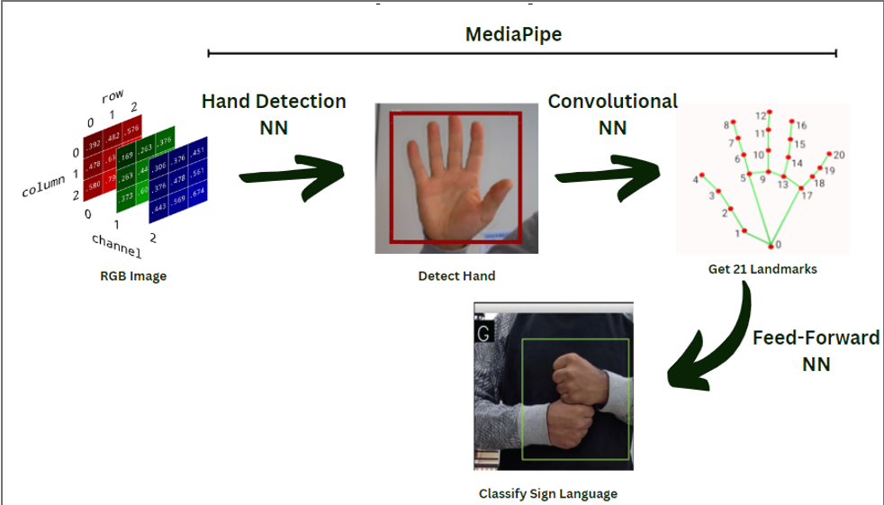
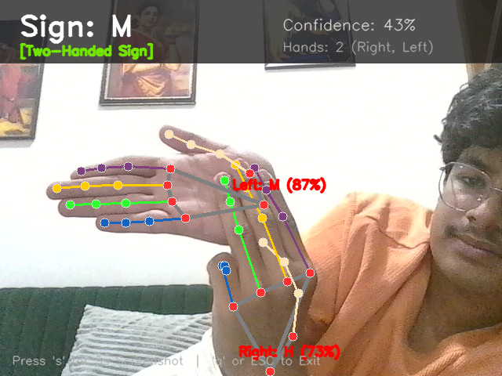
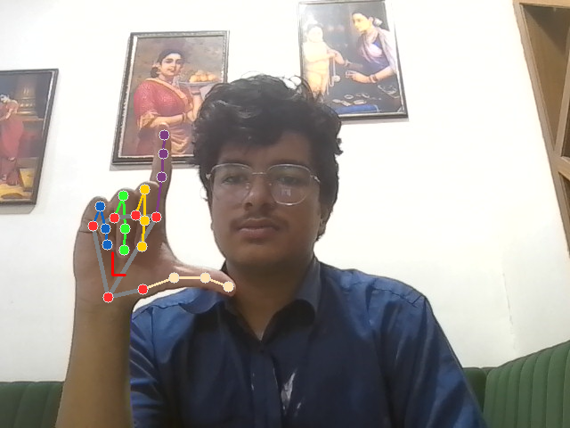

# SignSetu: Real-Time Indian Sign Language (ISL) Recognition System

A real-time Computer Vision and Deep Learning framework designed to detect, track, and classify Indian Sign Language (ISL) hand gestures using standard webcam video feeds.

---

## Abstract & Motivation

Indian Sign Language (ISL) serves as the primary mode of visual communication for millions in the deaf and hard-of-hearing community across India. Unlike American Sign Language (ASL) which predominantly utilizes single-handed finger-spelling, ISL encompasses a rich vocabulary of both **two-handed gestures** (such as **A**, **B**, **D**, **H**, **M**, **P**, **W**) and **single-handed gestures** (such as **C**, **L**, **O**, and numbers **1–9**).

**SignSetu** bridges communication barriers by providing an automated, real-time gesture recognition interface. The system captures live video, tracks hand landmarks using Google MediaPipe, extracts invariant spatial features, and classifies the signs using a deep neural network classifier—delivering instant visual feedback through an interactive Heads-Up Display (HUD).

---

## Key Features

* **Multi-Hand Tracking**: Real-time detection and 3D coordinate estimation for up to two hands simultaneously using MediaPipe Hands.
* **Joint Two-Hand Fusion Engine**: Evaluates joint probability distributions when both hands are presented, enabling accurate classification of two-handed ISL alphabets.
* **Single-Hand & Dual-Hand Mode Intelligence**:
  * Detects 1-handed signs (**C**, **L**, **O**, **1–9**) with single-hand input.
  * Detects 2-handed signs (**A**, **B**, **M**, **H**, etc.) when both hands work in coordination.
  * Provides on-screen guidance if a two-handed gesture is attempted with only one hand.
* **High-Throughput Vectorized Inference**: Utilizes direct batch tensor execution for smooth, low-latency performance at 30+ FPS.
* **Temporal Smoothing & Stabilization**: Implements rolling majority-voting queues to eliminate high-frequency camera noise and prevent flickering.
* **Interactive Heads-Up Display (HUD)**:
  * Prominent display of recognized sign and confidence percentage.
  * Dynamic status badge indicating gesture mode ([Two-Handed Sign], [Single-Handed Sign], or [Needs 2nd Hand]).
  * Live hand tracking count and individual wrist annotations.
* **Integrated Screenshot Capture**: Press 's' to trigger a 5-second countdown timer for capturing clean verification frames with annotations.

---

## System Architecture & Pipeline

The end-to-end processing pipeline operates in five continuous stages:

1. **Video Acquisition**: Live frames are acquired from the webcam using OpenCV and converted to RGB.
2. **Landmark Extraction**: MediaPipe Hands extracts 21 3D skeletal landmark coordinates \((x, y, z)\) for each detected hand.
3. **Feature Preprocessing & Normalization**:
   * Landmark coordinates are translated relative to the wrist origin (landmark 0).
   * Coordinates are normalized by the maximum coordinate spread, ensuring scale and distance invariance.
   * Flattened into a standardized 42-dimensional feature vector per hand.
4. **Deep Neural Network Classification**:
   * A multi-layer Feedforward Neural Network (FNN) processes the feature vectors.
   * Model architecture comprises dense hidden layers with ReLU activations, dropout regularization (0.5), and a 35-class Softmax output layer.
5. **Joint Probability Fusion & HUD Rendering**:
   * Combines per-hand predictions and outputs the stabilized sign classification directly onto the video stream.

---

## Live Output Demonstrations

| Two-Handed Sign Recognition ('M') | Single-Handed Sign Recognition ('L') |
|:---:|:---:|
|  |  |
| *Simultaneous two-hand tracking with joint fusion classification* | *Single-hand skeletal tracking with real-time HUD feedback* |

---

## Gestures Covered (35 Classes)

| Category | Classes | Hand Mode |
|:---|:---|:---|
| **Numeric Digits** | 1, 2, 3, 4, 5, 6, 7, 8, 9 | Single-Handed |
| **Alphabetic Characters** | C, I, L, O, U, V | Single-Handed |
| **Alphabetic Characters** | A, B, D, E, F, G, H, J, K, M, N, P, Q, R, S, T, W, X, Y, Z | Two-Handed |

---

## Project Structure

`	ext
Indian-Sign-Language-Detection/
│
├── isl_detection.py               # Main application for live webcam recognition & HUD
├── dataset_keypoint_generation.py  # Script for extracting MediaPipe landmarks from dataset
├── ISL_classifier.ipynb           # Model architecture, training pipeline, and evaluation
├── model.h5                       # Pre-trained deep neural network model weights
├── keypoint.csv                   # Extracted 42-dimensional landmark coordinate dataset
├── requirements.txt               # Project dependencies and package versions
│
├── images/                        # Architectural diagrams & demonstration assets
│   ├── allGestures.png            # ISL reference chart of all 35 gestures
│   ├── process.png                # System processing workflow diagram
│   ├── example1.png               # Demonstration: Two-handed recognition (Sign M)
│   └── example2.png               # Demonstration: Single-handed recognition (Sign L)
│
└── screenshots/                   # Destination for user-captured verification screenshots
`

---

## Installation & Setup

### Prerequisites
* Python 3.8 or higher
* Standard webcam or integrated camera

### Step 1: Clone or Navigate to Project Directory
`powershell
cd Indian-Sign-Language-Detection
`

### Step 2: Create and Activate Virtual Environment
`powershell
python -m venv .venv
.\.venv\Scripts\activate
`

### Step 3: Install Required Dependencies
`powershell
pip install -r requirements.txt
`

### Step 4: Run Live Recognition
`powershell
python isl_detection.py
`

---

## Controls

| Key | Action |
|:---|:---|
| **s** | Start a 5-second countdown to save a high-resolution screenshot to screenshots/ |
| **q** or **ESC** | Gracefully stop the video stream and exit the application |

---

## Model Training & Performance Metrics

* **Classifier Architecture**: Multi-Layer Perceptron (Input: 42 \(\rightarrow\) 1470 \(\rightarrow\) 832 \(\rightarrow\) 428 \(\rightarrow\) 264 \(\rightarrow\) Output: 35)
* **Optimization**: Adam Optimizer with Sparse Categorical Crossentropy loss
* **Regularization**: 50% Dropout across intermediate layers with EarlyStopping on validation loss
* **Performance Metrics**:
  * **Accuracy**: > 99.8% on held-out validation dataset
  * **Precision / Recall / F1-Score**: 0.99+ across evaluated gesture classes

---

## Future Scope

1. **Continuous Sentence Formation**: Integrate Recurrent Neural Networks (LSTM/GRU) or Transformers to interpret full sign sentences and temporal transitions.
2. **Speech Synthesis**: Add Text-to-Speech (TTS) integration to vocalize recognized gestures for seamless two-way communication.
3. **Mobile & Edge Deployment**: Quantize model weights using TensorFlow Lite for lightweight execution on Android and Raspberry Pi devices.
